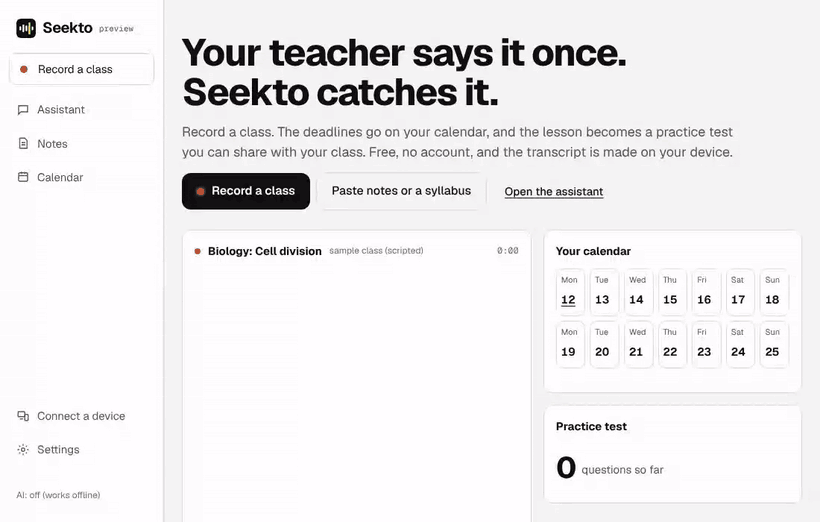

# Seekto

**Your teacher says "the quiz is on Friday." Seekto puts it on your calendar and turns the lesson into a practice test you can share with your class.**

Free and open source. Private: no account, works without AI, and transcripts can be made on your own device.



**[Open Seekto →](https://enrjgy-tech.github.io/seekto/)** and press **Try a sample class**. No microphone, account or AI key needed.

## What it does

- **Record a class.** Seekto writes the transcript, live or privately on your device, with "lost here" marks and quick notes stamped to the second. Audio stays on your device.
- **Deadlines find themselves.** "The essay is due October 20th" or "el examen es el viernes" goes straight on your calendar. Import Canvas, Google Classroom, Moodle or Blackboard calendars too.
- **Practice tests from your own notes,** both ways (term to meaning, meaning to term), graded whether you type or say the answer. Export to Quizlet, Anki, Google Forms, Kahoot or Moodle.
- **Share a test with your class.** One link opens it on any phone, with nothing to install. The questions travel inside the link, so they're never stored on a server.
- **Ask about it.** "When is my math test?", "What's due this week?", "What is mitosis?" Type, or use talk mode.
- **Assignments.** Paste the rubric to get a checklist and a schedule back from the due date, with your related notes and YouTube sources beside it.

## Why it's different

- **No AI needed.** Dates, deadlines, definitions and quizzes come from tested rules in [`engine/`](engine/src), in English and Spanish. Add an AI model only if you want one: Ollama on your computer, free models on OpenRouter, or OpenAI or Anthropic with your own key.
- **Private transcripts in any language.** Whisper can run in your browser: no audio leaves your device, it works offline after a one-time download, in about 100 languages and any modern browser.
- **Your notes stay yours.** Everything lives in your browser. Connect your phone and laptop with a 6-letter code and they sync directly, encrypted. Optional storage goes to a Supabase project *you* own, end-to-end encrypted with a key only you hold. Seekto has no server and no accounts to hack.

## Also for meetings

Switch to **Work** and the same app records meetings, after a consent check every time. It pulls out decisions and action items (who does what, by when), puts dated ones on your calendar and drafts a follow-up email for you to check and send yourself.

<details><summary>See the full tour: a class, a shared test and a meeting</summary>


</details>

## Privacy, in short

Everything you create stays in your browser unless you turn on sync. Device sync goes directly between your devices; a public message service (ntfy.sh, or your own) only helps them find each other. Storage sync is end-to-end encrypted in a database you own. AI is off until you choose a provider, and then only what you ask about is sent to it. There are no trackers or analytics. The details, including what each service can see, are in [docs/PRIVACY.md](docs/PRIVACY.md).

Transcripts are made either live by your browser's speech service (online in Chrome and Edge) or privately on your device with Whisper; you choose in Settings. Follow your school's and workplace's rules about recording.

## Run it locally

```sh
git clone https://github.com/enrjgy-tech/seekto.git
cd seekto
npm test          # engine tests: dates, meetings, calendars, quizzes, share links, sync, encryption
npm run build     # builds the static site into ./site
npm run serve     # serves ./site locally
```

No dependencies and no build step for the app. Node 20 or newer for the tests.

## How it's built

- **`app/`**: the web app in plain HTML, CSS and JavaScript modules. It installs as an app and opens offline after the first visit.
- **`engine/`**: the tested logic, usable on its own:
  - dates and deadlines in speech and text;
  - decisions and action items in meetings;
  - definitions, quizzes and answer checking;
  - share links;
  - .ics calendars;
  - questions like "when is my test";
  - device pairing and sync rules;
  - account keys and end-to-end encryption;
  - requests to each AI provider.
- **`app/supabase.sql`**: the storage you can bring, checked in CI against Postgres.

## Contributing

There are good first issues for every skill level: teach Seekto a date phrase or a meeting phrase it misses (each is one test and one rule), add a storage adapter, test it on your phone or Chromebook, or improve accessibility. See [CONTRIBUTING.md](CONTRIBUTING.md), the [roadmap](ROADMAP.md) and the [launch plan](docs/LAUNCH.md).

## License

Code: [MIT](LICENSE). Geist fonts: [SIL Open Font License](app/fonts/OFL.txt).
